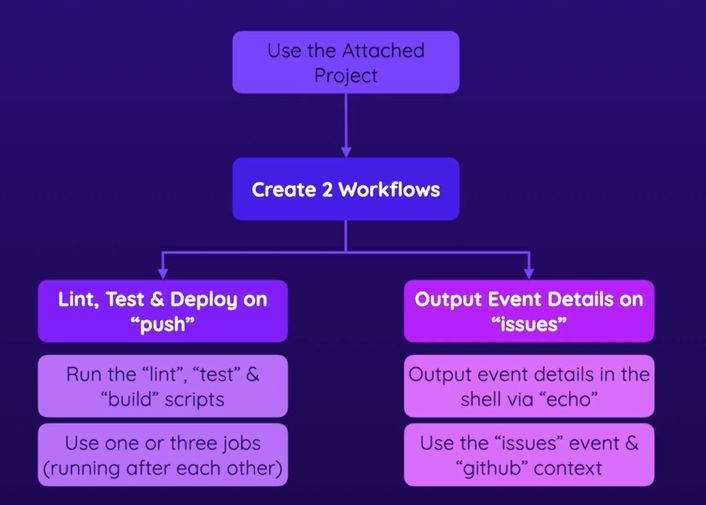

# Git commands
git init
- Initialize a Git repository (only required once per project)

git add
- Stage code changes (for the next commit)

git commit -m " ... "
- Create a commit for the staged changes (with a message)

git status
- Get the current repository status (e.g., which changes are staged)

git log
- Output a chronologically ordered list of commits

git checkout
- Temporarily move back to commit

git revert
- Revert the changes of commit (by creating a new commit)

git reset
- Undo commit(s) up to commit by deleting commits


# GitHub Actions 
## I. Basic Building Blocks & Components
### GitHub Actions Key Elements

GitHub Actions is a CI/CD and automation platform that enables you to automate build, test, and deployment workflows directly within GitHub,

#### 1. Workflow

A **workflow** is an automated process defined in a YAML file located in the `.github/workflows/` directory. A workflow contains one or more jobs and is triggered by events. 
```yaml
name: CI Pipeline
on: push
```

---

#### 2. Events (Triggers)

**Events** determine when a workflow runs. Common workflow triggers include:

- `push`
- `pull_request`
- `schedule`
- `workflow_dispatch`
- `release`

Example:

```yaml
on:
  push:
    branches:
      - main
```

---

#### 3. Jobs

A **job** is a set of steps that run on the same runner. Jobs run in parallel by default but can be configured to run sequentially when dependencies exist. 

```yaml
jobs:
  build:
    runs-on: ubuntu-latest
```

---

##### 4. Steps

A **step** is an individual task within a job. Steps execute sequentially and can either run commands or invoke actions. 

```yaml
steps:
  - run: npm test
```

---

#### 5. Actions

An **action** is a reusable component that performs a specific task, such as checking out source code, setting up a runtime environment, or deploying an application. 

```yaml
steps:
  - uses: actions/checkout@v4
```

---

#### 6. Runners

A **runner** is the environment that executes your workflow jobs. GitHub provides hosted runners, and you can also configure self-hosted runners. 
```yaml
runs-on: ubuntu-latest
```

##### Runner Types

- GitHub-hosted runners
- Self-hosted runners

---

#### 7. Secrets and Variables

**Secrets** securely store sensitive information such as API keys, passwords, and tokens. Variables are used to manage workflow configuration values. 
```yaml
env:
  APP_ENV: production
```

---

#### 8. Artifacts

**Artifacts** are files created during a workflow run that can be shared across jobs or downloaded after execution. Examples include build outputs, logs, and test reports. 


## Workflow Structure Overview

```text
Workflow
├── Event (Trigger)
├── Job 1
│   ├── Step 1
│   ├── Step 2
│   └── Action
└── Job 2
    ├── Step 1
    └── Step 2
```

## Summary

The core building blocks of GitHub Actions are:

1. **Workflow**
2. **Events (Triggers)**
3. **Jobs**
4. **Steps**
5. **Actions**
6. **Runners**
7. **Secrets and Variables**
8. **Artifacts**

Together, these components enable automated CI/CD pipelines and workflow automation within GitHub repositories. 

## Module Summary
### Core Components
- Workflows: Define Events + Jobs
- Jobs: Define Runner + Steps
- Steps: Do the actual work

### Defining Workflows
- .github/workflows/.yml (on GitHub or locally)
- GitHub Actions syntax must be followed

### Events / Triggers
- Broad variety of events (repository-related & other)
- Workflows have at least one (but possible more) event(s)
### Runners
- Servers (machines) that execute the jobs
- Pre-defined Runners (with different OS) exist
- You can also create custom Runners

### Workflow Execution
- Workflows are executed when their events are triggered
- GitHub provides detailed insights into job execution (+ logs)
 
### Actions
- You can run shell commands
- But you can also use pre-defined Actions (official, community or custom)

## Exercise


## Repositories
**1. First Action**

https://github.com/sherwin-ad/gh-first-action.git

**2. Second action React demo**

https://github.com/sherwin-ad/gh-second-action-react-demo.git

**3.  GH Exercise 1**

https://github.com/sherwin-ad/gh-exercise1.git

## II  Workflows & Events - Deep Dive

### Summary
#### Available Events
- There are many supported events
- Most are repository-related (e.g., push, pull_request)
- But some are more general (e.g., schedule)

#### Pull Requests & Forks
- Initial approval needed for pull requests from forked repositories
- Avoids spam from untrusted contributors

#### Activity Types
- The exact type of event that should trigger a workflow
- Examples: Opening or editing a pull request should trigger the wf

#### Cancelling & Skipping
- Workflows get cancelled automatically when jobs fail
- You can manually cancel workflows
- You can skip via [skip ci] etc. in commit message

#### Event Filters
- For push & pull_request: Add filters to avoid some executions
- Filter based on target branch and / or affected file paths

## III. Job Artifacts & Outputs
# GitHub Actions Job Artifacts Explained

## What Are Artifacts?

Artifacts in GitHub Actions are files or directories that a workflow job creates and saves so they can be:

- Downloaded later from the GitHub Actions UI
- Shared between jobs in the same workflow
- Preserved after the workflow finishes

Common examples:

- Build packages (`.jar`, `.zip`, `.exe`)
- Test reports
- Coverage reports
- Log files
- Generated documentation

## Why Use Artifacts?

Jobs run on separate runners, so files created in one job are not automatically available in another job.

Artifacts allow you to transfer files between jobs.

```text
Build Job
   |
   | Upload Artifact
   v
GitHub Artifact Storage
   |
   | Download Artifact
   v
Test Job
```

## Uploading an Artifact

```yaml
jobs:
  build:
    runs-on: ubuntu-latest

    steps:
      - uses: actions/checkout@v4

      - name: Build application
        run: |
          mkdir dist
          echo "Hello World" > dist/app.txt

      - name: Upload artifact
        uses: actions/upload-artifact@v4
        with:
          name: build-output
          path: dist/
```

## Downloading an Artifact

```yaml
jobs:
  test:
    needs: build
    runs-on: ubuntu-latest

    steps:
      - name: Download artifact
        uses: actions/download-artifact@v4
        with:
          name: build-output

      - name: List files
        run: ls -R
```

## Example: Sharing Build Output Between Jobs

```yaml
name: CI Pipeline

on: push

jobs:
  build:
    runs-on: ubuntu-latest

    steps:
      - uses: actions/checkout@v4

      - run: |
          mkdir output
          echo "Build completed" > output/result.txt

      - uses: actions/upload-artifact@v4
        with:
          name: build-files
          path: output/

  deploy:
    needs: build
    runs-on: ubuntu-latest

    steps:
      - uses: actions/download-artifact@v4
        with:
          name: build-files

      - run: cat output/result.txt
```

## Artifact Retention

```yaml
- uses: actions/upload-artifact@v4
  with:
    name: build-output
    path: dist/
    retention-days: 7
```

## Artifacts vs Cache

| Feature | Artifact | Cache |
|----------|----------|--------|
| Purpose | Save workflow outputs | Speed up builds |
| Shared Between Jobs | Yes | Yes |
| Downloadable from UI | Yes | No |
| Used for Build Results | Yes | Usually No |
| Used for Dependencies | Not Ideal | Yes |

## Common Use Cases

### Store Test Reports

```yaml
- uses: actions/upload-artifact@v4
  with:
    name: test-reports
    path: reports/
```

### Store Coverage Results

```yaml
- uses: actions/upload-artifact@v4
  with:
    name: coverage
    path: coverage/
```

### Store Build Packages

```yaml
- uses: actions/upload-artifact@v4
  with:
    name: release-package
    path: target/myapp.jar
```

## Key Points

- Artifacts are files/directories produced by a workflow.
- Use upload-artifact to save them.
- Use download-artifact to retrieve them in another job.
- Jobs run on separate runners, so artifacts are the standard way to transfer files between jobs.
- Artifacts are retained for a configurable period.

> Need a file later? Use an artifact. Need faster builds? Use a cache.

## IV.  GitHub Actions Job Outputs Explained

## What Are Job Outputs?

Job outputs are values produced by one job and passed to another job in the same workflow.

Unlike **artifacts**, which are used to transfer files, **job outputs** are used to transfer small pieces of data such as:

- Version numbers
- Build IDs
- Commit hashes
- Environment names
- URLs
- Status information

---

## Artifacts vs Job Outputs

### Job Outputs

- Transfer text values and metadata
- Not intended for files
- Available only during workflow execution
- Best for versions, URLs, IDs, and other small values

### Artifacts

- Transfer files and directories
- Downloadable from the GitHub Actions UI
- Persist after workflow completion (based on retention settings)
- Best for build packages, reports, and logs

### Rule of Thumb

- Need to share a **string or value** → Use **Job Outputs**
- Need to share a **file or folder** → Use **Artifacts**

---

## How Job Outputs Work

### Step 1: Create a Step Output

A step writes a value to `$GITHUB_OUTPUT`.

```yaml
jobs:
  build:
    runs-on: ubuntu-latest

    outputs:
      version: ${{ steps.set_version.outputs.version }}

    steps:
      - id: set_version
        run: echo "version=1.2.3" >> $GITHUB_OUTPUT
```

In this example:

- Step ID: `set_version`
- Output name: `version`
- Output value: `1.2.3`

---

### Step 2: Expose the Step Output as a Job Output

```yaml
outputs:
  version: ${{ steps.set_version.outputs.version }}
```

This makes the value available to other jobs.

---

### Step 3: Consume the Job Output

```yaml
deploy:
  needs: build
  runs-on: ubuntu-latest

  steps:
    - run: echo "Deploying version ${{ needs.build.outputs.version }}"
```

Output:

```text
Deploying version 1.2.3
```

---

## Complete Example

```yaml
name: Job Outputs Example

on: push

jobs:
  build:
    runs-on: ubuntu-latest

    outputs:
      version: ${{ steps.version.outputs.version }}

    steps:
      - id: version
        run: echo "version=2.5.0" >> $GITHUB_OUTPUT

  deploy:
    needs: build
    runs-on: ubuntu-latest

    steps:
      - name: Deploy
        run: |
          echo "Deploying version:"
          echo "${{ needs.build.outputs.version }}"
```
### Caching Dependencies

- In GitHub Actions, caching dependencies is a technique used to save downloaded packages, libraries, or build artifacts between workflow runs. This speeds up CI/CD pipelines because dependencies don't need to be downloaded and installed every time.

**Why Cache Dependencies?**

Without caching:

1. Workflow starts.
2. Downloads dependencies from the internet.
3. Installs them.
4. Runs tests/build.
5. Finishes.

Every run repeats the same downloads.

With caching:

1. Workflow checks if dependencies already exist in the cache.
2. If found (cache hit), dependencies are restored immediately.
3. If not found (cache miss), dependencies are downloaded and then stored in the cache for future runs.

This can reduce build times significantly.

## Using Environment Variables & Secrets
